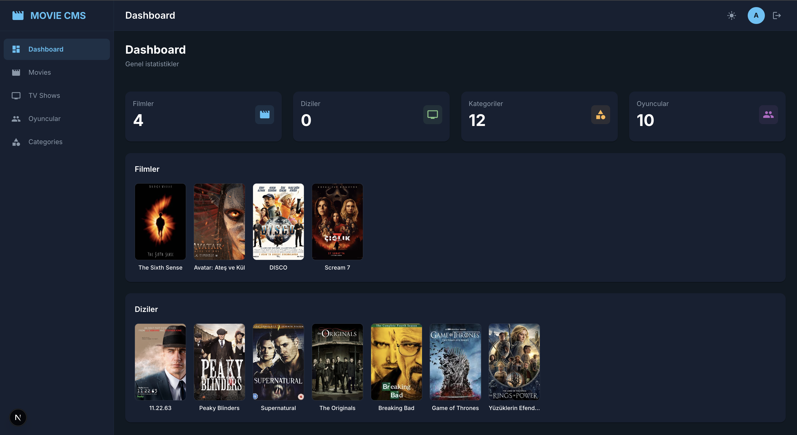

# Movie CMS

Filmleri, dizileri, oyuncuları ve kategorileri yönetmek için geliştirilmiş bir yönetim paneli.



## Özellikler

- **Dashboard**: film, dizi, kategori ve oyuncu sayıları ile afiş önizlemeleri
- **Filmler ve Diziler**: ekleme, düzenleme, silme, afiş yükleme, oyuncu ve kategori atama
- **Oyuncular** ve **Kategoriler** için CRUD işlemleri
- Arama, filtreleme ve sayfalama
- Supabase Auth ile giriş; `/admin` sayfaları sadece giriş yapmış kullanıcılara açık
- Açık / koyu tema

## Teknolojiler

- [Next.js 16](https://nextjs.org) (App Router) + React 19 + TypeScript
- [MUI](https://mui.com) ve Tailwind CSS
- Redux Toolkit
- React Hook Form + Zod
- [Supabase](https://supabase.com) (veritabanı, kimlik doğrulama, depolama)

## Kurulum

1. Bağımlılıkları yükle:

   ```bash
   npm install
   ```

2. Proje kök dizininde `.env.local` dosyası oluştur ve Supabase bilgilerini ekle (Supabase panelinde **Project Settings → API**):

   ```env
   NEXT_PUBLIC_SUPABASE_URL=https://<proje-id>.supabase.co
   NEXT_PUBLIC_SUPABASE_ANON_KEY=<anon-key>
   SUPABASE_SERVICE_ROLE_KEY=<service-role-key>
   ```

3. Geliştirme sunucusunu başlat:

   ```bash
   npm run dev
   ```

   Uygulama [http://localhost:3001](http://localhost:3001) adresinde açılır.

4. Giriş yapmak için Supabase panelinde **Authentication → Users → Add user** ile bir kullanıcı oluştur.

## Proje Yapısı

```
src/
├── app/
│   ├── admin/       # Panel sayfaları (dashboard, movies, tvshows, actors, categories)
│   ├── api/         # API route'ları (Supabase ile konuşur)
│   └── auth/        # Giriş sayfası
├── components/      # Ortak arayüz bileşenleri
├── features/        # Özelliğe göre gruplanmış bileşenler, hook'lar ve servisler
├── hooks/
├── lib/             # Supabase istemcileri, axios, Redux store
├── types/
└── middleware.ts    # /admin için oturum kontrolü
```

## Komutlar

| Komut           | Açıklama                         |
| --------------- | -------------------------------- |
| `npm run dev`   | Geliştirme sunucusu (port 3001)  |
| `npm run build` | Production derlemesi             |
| `npm start`     | Production sunucusu              |
| `npm run lint`  | ESLint kontrolü                  |
